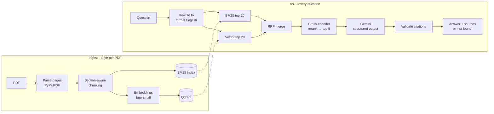

# 📘 RuleBook AI

[](https://github.com/Pra1bhas/rulebook-ai/actions/workflows/tests.yml)

**A free assistant that helps ordinary people in India deal with everyday problems (bank complaints, defective products, data misuse, RTI) using official rules. Ask in English or Telugu-English. Every answer cites the exact document, page and section, and if the documents don't cover something it says "not found" instead of guessing.**

## What it does

| Mode | You type | You get |
|---|---|---|
| ❓ **Ask** | "Can I withdraw my consent?" | A short answer + clickable sources (opens the PDF at the right page) |
| 🛠️ **Solve my problem** | "My bank has not replied to my complaint for 45 days." | Your rights → steps to take now → where to complain → a ready-to-send **draft letter**, every point cited |
| 📁 **My documents** | Upload your own PDFs (rent agreement, loan papers…) | Ask about them too. **Private to your browser**, auto-deleted after 24 h |

**Built-in official library** (`data/raw`): DPDP Act 2023 · DPDP Rules 2025 · Consumer Protection Act 2019 · RTI Act 2005 · RBI Integrated Ombudsman Scheme 2026 (FAQs). Drop more PDFs into `data/raw` and they are indexed on the next start.

### Real-world engineering
- **Multi-tenant RAG:** every chunk has an `owner`; BM25 and Qdrant filter by it, so one user's uploads never appear in another user's answers.
- **Problem solver:** the LLM splits a messy problem into 1-3 search queries; results are taken round-robin per query so one issue can't crowd out another. Any plan point without a valid source is dropped.
- **Free-tier protection:** answer cache (repeat question: 20 s → 0.02 s, no LLM call) and per-user + per-IP rate limits. Gemini 429/503 → exponential backoff → automatic fallback to Groq.
- **Safe uploads:** PDF magic-byte check, size/page/count limits, files deleted right after indexing; adding *public* documents needs an admin key.

## How it works



| Part | Choice | Why |
|---|---|---|
| Parsing | PyMuPDF | Fast, keeps page numbers; strips repeated headers/footers |
| Chunking | Section-aware, 220 words, 40 overlap | Legal text is organised by sections, so each chunk knows its section for citations |
| Keyword search | BM25 | Exact terms like "KYC" or "8(6)" |
| Meaning search | `bge-small-en-v1.5` + Qdrant | Finds "share my data" ≈ "disclosure of personal data" |
| Merge | Reciprocal Rank Fusion | BM25 and cosine scores use different scales; RRF only uses ranks |
| Rerank | `bge-reranker-base` cross-encoder | Reads the question and chunk together, so it ranks more accurately than embeddings |
| LLM | Gemini (free tier) via one wrapper | Structured JSON output, retries on 429, Groq as backup |
| Anti-hallucination | Sources-only prompt + `found` flag + citation validation | Every cited source must be one we actually retrieved |

## Run locally

```bash
cp .env.example .env          # then paste your free Gemini key (aistudio.google.com)
python -m venv .venv && source .venv/bin/activate   # Windows: .venv\Scripts\activate
pip install -r requirements-dev.txt
# put PDFs in data/raw/
uvicorn app.api.main:app --reload --port 7860
```
Open http://localhost:7860 (chat UI) and http://localhost:7860/docs (API docs).

**With Docker (app + separate Qdrant server):**
```bash
docker compose up --build
```
Open http://localhost:8000 · Qdrant dashboard: http://localhost:6333/dashboard

## Tests & evaluation
```bash
pytest -q                          # 33 tests, no internet or API key needed (fake embedder + fake LLM)
python -m scripts.evaluate         # retrieval hit-rate@5 and MRR on data/eval/questions.json
python -m scripts.evaluate --llm   # also checks the "not found" behaviour
```

## API
| Method | Path | What it does |
|---|---|---|
| POST | `/ask` | `{"question": "..."}` → answer, found, citations |
| POST | `/solve` | `{"problem": "..."}` → rights, steps, escalation, draft letter, citations |
| POST | `/upload` | upload 1-5 PDFs, private to the `X-Session-Id` header |
| DELETE | `/documents/{doc_id}` | delete one of my uploads |
| GET | `/documents` | public library + my uploads |
| GET | `/files/{name}.pdf` | the public PDFs (citation links use `#page=N`) |
| POST | `/search` | top chunks only (debugging retrieval) |
| POST | `/admin/ingest` | add a public document (needs `X-Admin-Key`) |
| GET | `/health` | status + chunk count |

## Deploy
Free on Hugging Face Spaces (Docker). See [DEPLOY.md](DEPLOY.md).

## Project structure
```
app/
  config.py            settings from env / .env
  models.py            Pydantic data shapes
  llm.py               single LLM wrapper (Gemini / Groq), retry on 429/503, Groq fallback
  pipeline.py          ⭐ the whole flow: ingest + ask + solve, private uploads
  ingest/parser.py     PDF -> clean pages
  ingest/chunker.py    pages -> section-aware chunks
  retrieval/           bm25_index, embedder, vector_store, hybrid (RRF), reranker
  generation/answer.py prompt, query rewrite, citation validation + dedupe
  generation/solver.py problem -> sub-queries -> cited action plan + draft letter
  api/main.py          FastAPI endpoints, sessions, upload limits
  api/guard.py         answer cache + rate limiter
  static/index.html    chat UI
scripts/               ingest_folder.py, evaluate.py
tests/                 pytest suite
```

*Answers are for awareness only and are not legal advice. Always check the official source.*
